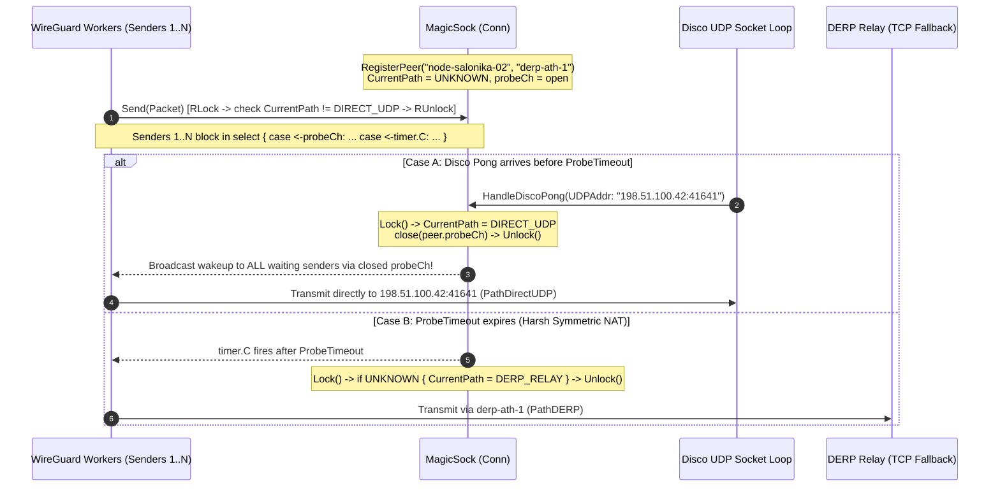
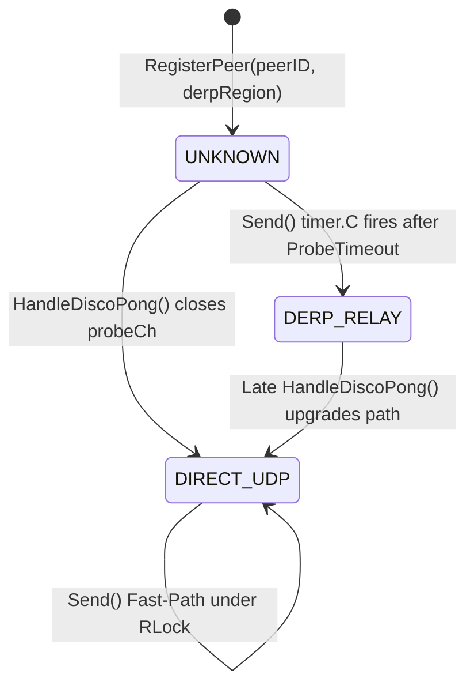

# Shadow Tutor Learning Guide: Ticket TELCO-402 (`MagicSock` NAT Traversal & DERP Fallback)

> [!IMPORTANT]
> **What We Solved in [TICKET-402.md](../../examples/telco-magicsock/TICKET-402.md#L1-L20):**
> 1. Eliminated `fatal error: concurrent map read and map write` crashes when 50+ worker goroutines call [`Conn.Send`](../../examples/telco-magicsock/conn.go#L76-L132) while asynchronous NAT hole-punching replies arrive in [`Conn.HandleDiscoPong`](../../examples/telco-magicsock/conn.go#L52-L72).
> 2. Replaced an indefinite channel block on `peer.probeCh` with a bounded `select` using [`time.NewTimer(c.ProbeTimeout)`](../../examples/telco-magicsock/conn.go#L102-L131) and a **channel-close broadcast** pattern so traffic falls back cleanly to **DERP** (`PathDERP`) on Symmetric NATs and immediately upgrades to **Direct UDP** (`PathDirectUDP`) when a Disco pong arrives.

---

## Layer 1: Protocol Mental Model (MagicSock, Disco Hole-Punching & DERP Fallback)

In a WireGuard mesh VPN (modeled after Tailscale's `magicsock`), WireGuard itself only encrypts packets—it expects an underlying socket layer to figure out **where** to send them across changing NATs and firewalls.

### The Three Routing States ([`PathState`](../../examples/telco-magicsock/packet.go#L6-L15))
1. **[`PathUnknown` (`"UNKNOWN"`)](../../examples/telco-magicsock/packet.go#L10)**: Initial state when a peer is registered via [`Conn.RegisterPeer`](../../examples/telco-magicsock/conn.go#L38-L48). No verified direct UDP endpoint exists yet, only a home [`DERPRegion`](../../examples/telco-magicsock/conn.go#L14).
2. **[`PathDERP` (`"DERP_RELAY"`)](../../examples/telco-magicsock/packet.go#L14)**: **Detoured Encrypted Routing Protocol**. When peers sit behind harsh Carrier-Grade or Symmetric NATs where UDP hole-punching takes time or fails, packets wait at most [`c.ProbeTimeout`](../../examples/telco-magicsock/conn.go#L102-L130) before routing over an encrypted TCP/HTTPS relay (`DERPRegion`) so customer voice/data traffic never blackholes.
3. **[`PathDirectUDP` (`"DIRECT_UDP"`)](../../examples/telco-magicsock/packet.go#L12)**: In the background, **Disco** (`Discovery`) ping/pong probes punch holes through NAT firewalls. As soon as an asynchronous [`DiscoPong`](../../examples/telco-magicsock/packet.go#L31-L35) arrives on the UDP socket, [`Conn.HandleDiscoPong`](../../examples/telco-magicsock/conn.go#L52-L72) records the peer's [`DirectAddr`](../../examples/telco-magicsock/conn.go#L62) and switches traffic onto the low-latency UDP fast-path.



---

## Layer 2: Codebase Call-Graph & State Transitions

Every peer's lifecycle is tracked in [`PeerState`](../../examples/telco-magicsock/conn.go#L10-L21) inside [`Conn.peers`](../../examples/telco-magicsock/conn.go#L27) and coordinated across three methods:



| Method | Lock Acquired | Reads / Writes on [`PeerState`](../../examples/telco-magicsock/conn.go#L10-L21) | Role in Pipeline |
| :--- | :--- | :--- | :--- |
| [`RegisterPeer`](../../examples/telco-magicsock/conn.go#L38-L48) | `c.mu.Lock()` | Initializes `CurrentPath: PathUnknown`, `DERPRegion`, and `probeCh: make(chan struct{})` | Sets up peer metadata and open broadcast channel before packets flow. |
| [`Send` (Fast Path)](../../examples/telco-magicsock/conn.go#L77-L93) | `c.mu.RLock()` | Reads `c.peers[pkt.PeerID]`, `peer.CurrentPath`, `peer.DirectAddr` | Zero-contention steady state: concurrent senders read `PathDirectUDP` in parallel. |
| [`Send` (Slow Path)](../../examples/telco-magicsock/conn.go#L97-L131) | `RLock` -> Unlock -> `select` -> `RLock` or `Lock` | Snapshots `probeCh` & `DERPRegion`; awaits `<-probeCh` or `<-timer.C`; upgrades `PathUnknown` -> `PathDERP` on timeout | Waits up to `ProbeTimeout` for NAT traversal without holding locks, then routes via Direct UDP or DERP. |
| [`HandleDiscoPong`](../../examples/telco-magicsock/conn.go#L52-L72) | `c.mu.Lock()` | Writes `CurrentPath = PathDirectUDP`, `DirectAddr`, `LastPongTime`; closes `probeCh` once (`probeClosed = true`) | Transitions peer to Direct UDP and broadcasts an immediate wakeup to all waiting `Send` calls. |

---

## Layer 3: Go Concurrency Mechanics Deep-Dive

### 1. `sync.RWMutex`: Reader Fast-Path vs. Writer Exclusivity
In [`Conn`](../../examples/telco-magicsock/conn.go#L24-L28), [`mu sync.RWMutex`](../../examples/telco-magicsock/conn.go#L26) protects both the `c.peers` map and the mutable fields of each `PeerState` struct:
- **Why `RWMutex` instead of `Mutex`?** Once a peer reaches [`PathDirectUDP`](../../examples/telco-magicsock/conn.go#L85), 99.9% of calls to [`Conn.Send`](../../examples/telco-magicsock/conn.go#L77-L93) only *read* `c.peers` and `peer.DirectAddr`. Using [`c.mu.RLock()`](../../examples/telco-magicsock/conn.go#L77) allows dozens of packet-sending goroutines (like the 30 concurrent senders in [`TestConcurrentSendAndDiscoPongUpgrade`](../../examples/telco-magicsock/conn_test.go#L27-L75)) to execute the fast path simultaneously without serializing on a single exclusive lock.
- **Why `c.mu.Lock()` on state transitions?** Both [`HandleDiscoPong`](../../examples/telco-magicsock/conn.go#L53) and the timeout fallback in [`Send`](../../examples/telco-magicsock/conn.go#L120-L124) mutate `peer.CurrentPath` (and `peer.DirectAddr` / `peer.probeClosed`). Go's memory model requires an exclusive write lock whenever mutating shared struct fields or maps to prevent torn reads and runtime map crashes.

### 2. Channel Broadcast Pattern (`close(peer.probeCh)` + `probeClosed` Guard)
Look at how [`HandleDiscoPong`](../../examples/telco-magicsock/conn.go#L68-L71) wakes waiting senders:
```go
if !peer.probeClosed {
    close(peer.probeCh)
    peer.probeClosed = true
}
```
- **Why `close(peer.probeCh)` instead of `peer.probeCh <- struct{}{}`?**
  1. **1-to-N Broadcast vs. 1-to-1 Signal**: A channel send (`ch <- v`) wakes **at most one** waiting goroutine. If 30 goroutines are waiting in [`Send`](../../examples/telco-magicsock/conn.go#L105-L106) for a probe to complete, sending a single value leaves the other 29 goroutines stuck until timeout! **Closing** a channel in Go immediately makes `<-probeCh` selectable (returning the zero value) for **every** currently waiting goroutine and any future reader.
  2. **Non-blocking when 0 waiters exist**: If a Disco pong arrives when *no* goroutine is blocked in `select`, `peer.probeCh <- struct{}{}` on an unbuffered channel would deadlock `HandleDiscoPong` forever. `close(peer.probeCh)` never blocks.
- **Why the `if !peer.probeClosed` guard?**
  As tested in [`TestConcurrentSendAndDiscoPongUpgrade`](../../examples/telco-magicsock/conn_test.go#L53-L63), networks can deliver multiple Disco pong packets from the same peer (`for j := 0; j < 5; j++`). In Go, calling `close()` on an already-closed channel triggers an unrecoverable runtime `panic: close of closed channel`. Guarding with [`peer.probeClosed`](../../examples/telco-magicsock/conn.go#L68-L71) under `c.mu.Lock()` guarantees idempotency.

### 3. Releasing `RLock` Before Blocking `select` & Cleaning Up `time.NewTimer`
Look carefully at lines [97–103 of `conn.go`](../../examples/telco-magicsock/conn.go#L97-L103):
```go
probeCh := peer.probeCh
derpRegion := peer.DERPRegion
c.mu.RUnlock()

timer := time.NewTimer(c.ProbeTimeout)
defer timer.Stop()
```
- **Why unlock *before* `select`?** In Go's `sync.RWMutex`, a writer calling `c.mu.Lock()` (inside [`HandleDiscoPong`](../../examples/telco-magicsock/conn.go#L53)) cannot acquire the lock until **all active readers have called `RUnlock()`**. If `Send()` held `RLock()` while waiting on `<-probeCh` inside `select`, `HandleDiscoPong()` would block forever waiting for `c.mu.Lock()`, which means it could never reach `close(peer.probeCh)`—a classic **lock-wait cycle deadlock**.
- **Why snapshot `probeCh` and re-acquire `RLock` after `<-probeCh`?** We copy the channel reference `probeCh := peer.probeCh` while holding `RLock()`, release `RLock()`, wait on `<-probeCh`, and then in [`case <-probeCh:`](../../examples/telco-magicsock/conn.go#L106-L110) re-acquire `c.mu.RLock()` to read `peer.DirectAddr` safely after `HandleDiscoPong` finishes writing it.
- **Why `time.NewTimer` + `defer timer.Stop()` instead of `time.After`?** In high-throughput packet loops, if `<-probeCh` wins the `select` in 1ms, a `time.After(c.ProbeTimeout)` timer remains allocated in the Go runtime heap until `ProbeTimeout` expires. Calling `defer timer.Stop()` immediately releases the timer resource on function exit.

---

## 3 "What-If" Mutation Experiments

Build your debugging intuition by tracing the exact failure mode if we mutate key lines in [`conn.go`](../../examples/telco-magicsock/conn.go):

### Experiment 1: Move `c.mu.RUnlock()` from [Line 99](../../examples/telco-magicsock/conn.go#L99) to `defer c.mu.RUnlock()` at [Line 77](../../examples/telco-magicsock/conn.go#L77)
- **The Mutation:** Suppose a developer thinks *"Why manually call `c.mu.RUnlock()` three times? Let's just use `defer c.mu.RUnlock()` right after `c.mu.RLock()` on line 77!"*
- **What Breaks:**
  1. **Deadlock with `HandleDiscoPong`**: A sender enters `select` at [line 105](../../examples/telco-magicsock/conn.go#L105) still holding `RLock`. When a pong arrives at [`HandleDiscoPong`](../../examples/telco-magicsock/conn.go#L53), `c.mu.Lock()` blocks waiting for `Send` to release `RLock`, so `probeCh` is never closed.
  2. **Self-Deadlock on Timeout**: Even worse, when `<-timer.C` fires at [line 117](../../examples/telco-magicsock/conn.go#L117), the same goroutine calls `c.mu.Lock()` at [line 120](../../examples/telco-magicsock/conn.go#L120) while still holding its own `RLock`! Go's `sync.RWMutex` is **not** upgradable or re-entrant—the goroutine deadlocks against itself permanently.

### Experiment 2: Delete the `if !peer.probeClosed` check at [Lines 68–71](../../examples/telco-magicsock/conn.go#L68-L71)
- **The Mutation:** Replace lines 68–71 with an unconditional `close(peer.probeCh)`.
- **What Breaks:** The very first `DiscoPong` succeeds, closing `peer.probeCh`. A few milliseconds later, a second NAT probe reply arrives (or a keepalive Disco pong arrives) and calls [`HandleDiscoPong`](../../examples/telco-magicsock/conn.go#L52). The daemon immediately crashes with `panic: close of closed channel` during [`TestConcurrentSendAndDiscoPongUpgrade`](../../examples/telco-magicsock/conn_test.go#L53-L63).

### Experiment 3: Delete `c.mu.RLock()` / `c.mu.RUnlock()` at [Lines 108–110](../../examples/telco-magicsock/conn.go#L108-L110) inside `case <-probeCh:`
- **The Mutation:** Read `addr := peer.DirectAddr` directly on line 109 without re-acquiring `c.mu.RLock()`, assuming *"Well, `probeCh` is already closed, so `DirectAddr` must already be set!"*
- **What Breaks:** Look at [`TestConcurrentSendAndDiscoPongUpgrade`](../../examples/telco-magicsock/conn_test.go#L53-L63) where 5 Disco pongs arrive concurrently. While Pong #1 closes `probeCh`, Pong #2 (perhaps from a secondary interface/port) can enter [`HandleDiscoPong`](../../examples/telco-magicsock/conn.go#L62) and write `peer.DirectAddr = pong.UDPAddr` at the exact same nanosecond `Send()` reads `peer.DirectAddr` unlocked. Running `go test -race ./...` will immediately flag a **DATA RACE** on `peer.DirectAddr`.

---

## 3 PR Defense Flashcards

Before opening your PR, test yourself on the exact questions a Staff Engineer will ask during review:

<details>
<summary><strong>Flashcard 1: "In <code>Send()</code> line 121, why do you check <code>if peer.CurrentPath == PathUnknown</code> before setting <code>peer.CurrentPath = PathDERP</code>?"</strong></summary>

**Answer:**
Because between the moment `<-timer.C` fires at [line 117](../../examples/telco-magicsock/conn.go#L117) and the moment `Send()` acquires `c.mu.Lock()` at [line 120](../../examples/telco-magicsock/conn.go#L120), [`HandleDiscoPong`](../../examples/telco-magicsock/conn.go#L52-L72) could have won the lock race and upgraded `peer.CurrentPath` to `PathDirectUDP`!
If we blindly wrote `peer.CurrentPath = PathDERP` without checking `if peer.CurrentPath == PathUnknown`, a late-finishing timeout would **downgrade** a newly established `PathDirectUDP` connection back to `PathDERP`.
</details>

<details>
<summary><strong>Flashcard 2: "Why did you use an unbuffered <code>chan struct{}</code> that gets closed, instead of a buffered channel or <code>sync.Cond</code>?"</strong></summary>

**Answer:**
1. **`chan struct{}` + `close()` vs. Buffered Channel:** A buffered channel of size `N` can only wake `N` senders, whereas any number of worker goroutines might call `Send()` concurrently during a burst. Closing an unbuffered `chan struct{}` allocates zero payload bytes and broadcasts an instant wakeup to **all** current and future readers.
2. **`chan struct{}` vs. `sync.Cond`:** `sync.Cond.Wait()` cannot be composed natively inside a `select` statement with a `time.Timer` (`case <-timer.C:`) without spawning extra helper goroutines per call.
</details>

<details>
<summary><strong>Flashcard 3: "If the first packet times out after <code>ProbeTimeout</code> (40ms) and sets <code>peer.CurrentPath = PathDERP</code>, what happens when a late <code>HandleDiscoPong</code> finally arrives?"</strong></summary>

**Answer:**
When the late `DiscoPong` arrives, [`HandleDiscoPong`](../../examples/telco-magicsock/conn.go#L61-L71) acquires `c.mu.Lock()`, upgrades `peer.CurrentPath` from `PathDERP` to `PathDirectUDP`, records `peer.DirectAddr`, and closes `peer.probeCh`. Every in-flight packet waiting in `select` and every subsequent call to `Send()` immediately shifts onto the `PathDirectUDP` fast-path!
</details>
